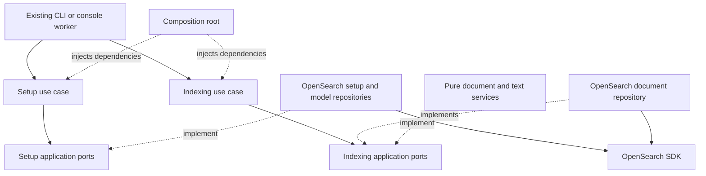

# Data embedding: setup and indexing

This module is split into two independent submodules. Start with their use cases:

- [Set up candidate OpenSearch resources](../backend/dataEmbedding/setup/application/useCases/setupCandidateOpenSearchResourcesUseCase.ts)
- [Embed candidates into OpenSearch](../backend/dataEmbedding/indexing/application/useCases/embedCandidatesIntoOpenSearchUseCase.ts)

Setup installs and checks resources. Indexing submits candidate documents to those
resources. Indexing never calls setup automatically. The existing UI buttons and
CLI commands remain the entry points, with the same arguments and results.

## Dependency direction



```text
backend/dataEmbedding/
  setup/
    application/
      useCases/
      ports/
    infrastructure/
      repositories/
      mappers/
      config/
  indexing/
    application/
      useCases/
      services/
      ports/
    infrastructure/
      repositories/
```

Use cases import ports and plain models, not concrete services, repositories,
configuration loaders or SDKs. Application services implement their ports and
perform pure transformations. Infrastructure implements external I/O. SDK payload
construction and response validation stay in infrastructure. Setup has no empty
application service classes: its pure work is SDK payload mapping, so it belongs
in infrastructure mappers.

The dependency test also follows imports through shared models and ports. Neither
submodule can import the other. Application code cannot reach the filesystem,
process environment, SDKs or an implicit clock. The composition root injects the
clock; the pure document preparation service does not create timestamps.

[createCandidateEmbedding.ts](../backend/composition/createCandidateEmbedding.ts)
wires the implementations. The existing application composition retains the same
connection lifetimes, dataset locks, configuration validation and host entry points.

## Setup flow

`SetupCandidateOpenSearchResourcesUseCase.execute` reads in this order:

1. Read the existing index and reject incompatible mappings.
2. Find the configured/named model, or create its connector and register it.
3. Reject a different model on an existing index.
4. Check an existing ingest pipeline for compatible embedding settings.
5. Simulate the same remote embedding and validate its vector dimensions.
6. Install the ingest pipeline.
7. Install the existing search pipeline.
8. Create the index, or update the existing index's default pipeline setting.

The use case receives `CandidateOpenSearchResources` and `CandidateEmbeddingModel`
ports. `CandidateOpenSearchSetupRepository` owns index/pipeline SDK calls and
response validation. `CandidateEmbeddingModelRepository` owns model/connector
lookup, validation and registration. Two pure request mappers construct their
payloads. The index configuration JSON was moved without changing its bytes.

Search pipeline configuration still belongs to search. Composition supplies it to
the setup repository; setup does not choose new ranking settings. The 25% lexical
and 75% vector weighting remains unchanged.

## Indexing flow

`EmbedCandidatesIntoOpenSearchUseCase.execute`:

1. Load all candidates from the selected source, or the requested unique IDs.
2. Report the initial count.
3. For each group of 100 candidates, check for a stop request.
4. Prepare documents, retaining the original candidate/skill normalization rules.
5. Delete stale documents when CV removal leaves no professional search content.
6. Submit the prepared documents and report the completed batch.
7. Return the same indexed/skipped counts and optional deleted count.

Candidate JSON files can still contain 1,000 records. Those files remain selected
and processed sequentially by the host. The 100-candidate preparation/bulk bound
is independent of the file size. File validation, fingerprint checks, receipts and
locking retain their existing ownership and behavior.

| Pure service | Responsibility |
| --- | --- |
| `PrepareCandidateOpenSearchDocumentService` | Normalize skills, skip empty search text, assemble the untimestamped document |
| `GenerateCandidateDisplayProfileService` | Produce the existing human-readable profile |
| `GenerateCandidateSearchTextService` | Produce the professional text submitted for embedding |
| `FormatCandidateProfessionalDetailsService` | Format resolved professional details and omit unresolved lookup values |
| `FormatCandidateCvTextService` | Format CV summary, skills, employment, projects, education, training and languages |

The use case adds the timestamp after document preparation using the injected
clock, preserving the former timestamp point. The display profile still contains
identity/location/salary where present; the embedding text still excludes those
fields. These outputs keep their original punctuation, ordering and separators.

`CandidateOpenSearchDocumentRepository` checks enriched mappings once per instance,
writes at most 100 documents per bulk request, and uses stable Salesforce IDs.
OpenSearch's ingest pipeline calls Bedrock to generate the actual vectors. The
application does not generate vectors locally or send a new embedding request type.

Retries remain selective: statuses 429, 502, 503 and 504 are retried, with at most
four attempts and delays of 1, 2 and 4 seconds. Successful documents are not retried.
Permanent indexing errors retain the original aggregate message; deletion errors
retain the original first-failure behavior. Missing acknowledgements still fail.
Deleting an already absent document remains successful.

## Shared contracts and scope

`CandidateDocument` now lives in `candidateData/models/` and
`OpenSearchCandidateDocumentMapper` lives in `candidateData/mappers/`. Embedding
and search use the same shared representation. Search received import-path changes
only. The mapper's serialization, validation and restoration behavior is unchanged.

This pass does not refactor preparation, Angular, host operation logic, search
queries or ranking. It does not claim the rest of the backend has already received
this same architectural restructuring. The earlier preparation entry points still
use their existing names until separately reviewed.

All new production classes use explicit public/private methods, constructor
injection, braces on conditions and loops, and camelCase filenames matching their
primary class. There are no ternaries or compressed method bodies in this module.

## Verification and unchanged tests

```powershell
npm run test:baseline
npm run build
```

Before the refactor, the baseline passed 85 backend tests, two offline contract
tests and three browser workflows. After the refactor, the same tests passed with
all 88 expected artifacts byte-identical. The 92 frozen input/expected/manifest
files were not edited.

Two additional checks in `tests/dataEmbeddingArchitecture.test.ts` enforce the
application dependency boundaries, submodule separation and requested code style.
The backend suite now contains 87 tests. Existing test bodies and assertions were
not changed: import aliases point to the new implementations or construction-only
test drivers. Those drivers inject the new ports and split services; they do not
reimplement candidate normalization, text generation, retry policy or setup logic.
The golden HTTP/CLI/worker scenario runs the production composition directly.

No Salesforce or AWS live tests are part of this validation. As documented in the
[offline baseline](offline-refactor-baseline.md), the comparison proves application
outputs and outgoing SDK requests for the frozen scenarios, not real service
availability, Bedrock vectors or search relevance.
