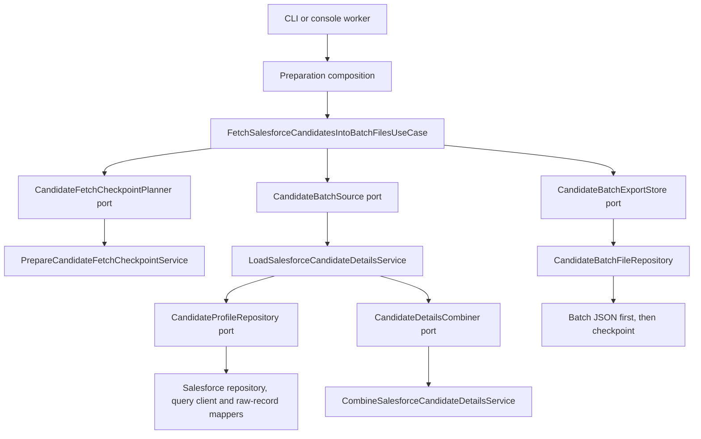
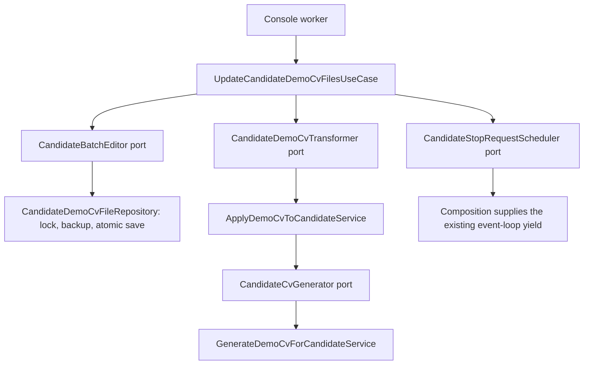

# Data preparation: Clean Architecture

Preparation has two independent workflows: fetching Salesforce candidates into
batch files, and adding or removing demo CV data in those files. Each workflow
has its own use case with dependencies supplied through constructor interfaces.
Start with the use cases; follow their ports to the services or repositories
constructed in [createCandidatePreparation.ts](../backend/composition/createCandidatePreparation.ts).

## Layers and reading order

```text
shared/domain/models/
  candidate.ts
  candidateEnrichment.ts
  candidateCvProfile.ts
backend/dataPreparation/
  application/
    useCases/
      fetchSalesforceCandidatesIntoBatchFilesUseCase.ts
      updateCandidateDemoCvFilesUseCase.ts
      fetchSelectedSalesforceCandidatesIntoFileUseCase.ts
    services/
      loadSalesforceCandidateDetailsService.ts
      combineSalesforceCandidateDetailsService.ts
      generateDemoCvForCandidateService.ts
      applyDemoCvToCandidateService.ts
      prepareCandidateFetchCheckpointService.ts
    ports/
    models/
  infrastructure/
    repositories/
    mappers/
    config/
    fixtures/
```

| Layer | Responsibility |
| --- | --- |
| Shared domain models | Candidate, tag, enrichment and CV contracts, independent of frameworks and I/O |
| Application use cases | Sequence work, hold dataset locks through ports, report progress and respect stop boundaries |
| Application services | Load relationships through ports; combine details, generate/apply CV data and validate checkpoints |
| Application ports | Interfaces for repositories, transformations, quality summaries and scheduling |
| Application models | Requests, progress/results and intermediate profile/association shapes |
| Infrastructure repositories | Salesforce authentication, schema inspection, queries, continuations and snapshot persistence |
| Infrastructure mappers | Pure translation of raw Salesforce records into application/domain data |
| Composition | Construct and inject concrete dependencies; authenticate for fetching only |

File operations shared by preparation, embedding and dataset previews stay in
`backend/candidateData/`: ports define the contracts; repositories own locking,
atomic writes, backups, checkpoints and snapshot serialization. Preparation use
cases import those ports, not the repositories. The existing shared quality
summary implementation is injected through `CandidateQualitySummarizer`.

## Fetch candidates into batch files

Read [FetchSalesforceCandidatesIntoBatchFilesUseCase](../backend/dataPreparation/application/useCases/fetchSalesforceCandidatesIntoBatchFilesUseCase.ts):

1. Validate the request, then acquire the dataset lock.
2. Load and validate the checkpoint, or save the initial checkpoint.
3. Fetch the next bounded candidate batch through `CandidateBatchSource`.
4. Validate that the batch size and cursor advance are acceptable.
5. Save the candidate file, report quality, then save the next checkpoint.
6. Report the committed batch and repeat until the requested limit, completion or stop.



The loader retrieves Contact profiles, associations, tags and recursive parents,
then employers. It groups associations and calls the pure combination service in
the same order as before. Batched lookups, continuation handling, hierarchy guards,
scope fingerprints, warning order and selected-ID deduplication remain unchanged.
There are no new per-candidate queries or background tasks.

The selected-ID snapshot command uses
[FetchSelectedSalesforceCandidatesIntoFileUseCase](../backend/dataPreparation/application/useCases/fetchSelectedSalesforceCandidatesIntoFileUseCase.ts).
Its injected `PersistFetchedCandidatesRepository` saves a successful retrieval
before returning it. This preserves the existing snapshot-before-indexing behavior.

## Update demo CV data

Read [UpdateCandidateDemoCvFilesUseCase](../backend/dataPreparation/application/useCases/updateCandidateDemoCvFilesUseCase.ts).
It locks the dataset, sorts selected filenames, reads one file at a time, transforms
its candidates, saves changed files and reports progress. The four actions remain:

| Action | Existing behavior |
| --- | --- |
| Preview | First 20 candidates in the first sorted file; no writes |
| Add | Generate missing demo CVs; skip existing ones |
| Regenerate | Replace synthetic CV data using the supplied seed |
| Remove | Remove synthetic CV data and retain the removal marker for indexing |



CV generation keeps the same seed/hash algorithm, seven profile templates and
candidate-field order. Applying a CV remains a pure transformation. The use case
finishes the current file before stopping. Scheduling is injected; the application
does not call timers or read the process environment. CV actions construct only
local file and transformation dependencies, requiring no Salesforce or AWS login.

## Why the domain is thin

The domain models already existed as shared plain TypeScript types. They now live
explicitly in `shared/domain/models/`, where backend and UI can both use them
without depending on each other. A domain layer does not require entity classes
with invented methods. This application currently transforms candidate records;
its use-case policies and pure transformations remain in application services.

`shared/candidateConsoleContracts.ts` stays outside the domain because it describes
HTTP/worker/UI communication. `CandidateDocument` stays in
`backend/candidateData/models/` because it represents the indexed document, including
search-specific fields. Neither is a core candidate domain model.

## Behavior verification

Run the existing offline verification command:

```powershell
npm run test:baseline
```

The same scenarios compare 88 frozen artifacts byte-for-byte under the documented
fixed-clock and operation-envelope rules. Fixture inputs, expected artifacts and
the manifest are unchanged. Test-only construction drivers now build the separate
use cases; module paths follow moved source files. Existing assertions remain.

Verification passed: 90 backend tests, two contract tests, three browser workflows,
type checking, the Angular build and the backend build. No live AWS or Salesforce
calls were made.

New architecture tests enforce inward application dependencies, isolated domain
contracts, explicit method access, braces and camelCase class filenames. The
checkpoint validator retains its existing pure Zod schema to preserve validation
behavior and error formatting.

The known history-reader failure after an `enrich` operation remains characterized
by the same test. Fixing it is a separate behavior change. Angular, embedding and
search logic are unchanged; their shared-model imports follow the domain move.
Search's 25%/75% combination and its lexical/vector settings remain unchanged.

See [offline baseline coverage](offline-refactor-baseline.md) and
[embedding architecture](dataEmbeddingRefactor.md) for the adjacent modules.
