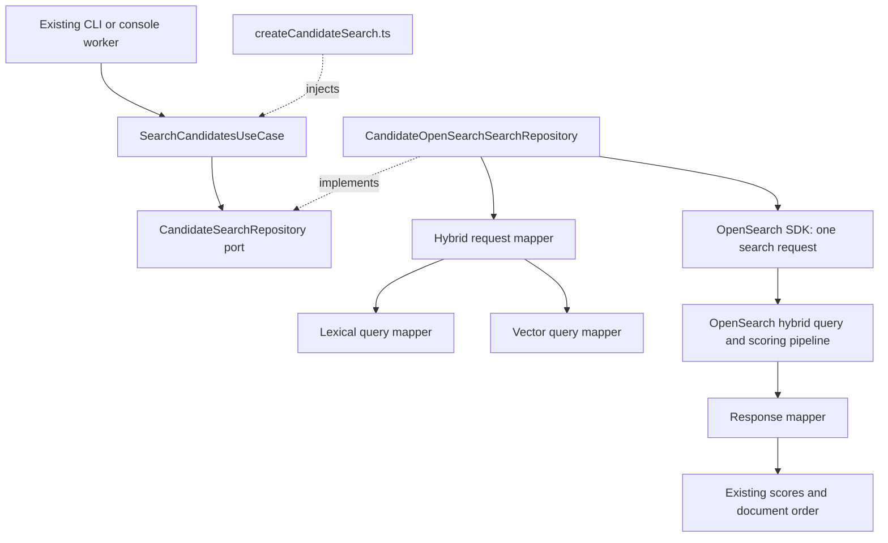

# Candidate search: Clean Architecture

Start with [SearchCandidatesUseCase](../backend/dataSearch/application/useCases/searchCandidatesUseCase.ts).
It validates the query and result limit, calls the injected search repository,
and returns its results. Lexical and vector searches are clauses in one OpenSearch
hybrid request. OpenSearch normalizes and combines their scores through the
configured search pipeline. The backend restores documents in the returned order.

## Structure and responsibilities

```text
backend/dataSearch/
  application/
    useCases/
      searchCandidatesUseCase.ts
    ports/
      candidateSearchRepository.ts
    models/
      candidateSearchResult.ts
  infrastructure/
    repositories/
      candidateOpenSearchSearchRepository.ts
    lexicalSearch/
      candidateLexicalQueryMapper.ts
    vectorSearch/
      candidateVectorQueryMapper.ts
    mappers/
      candidateHybridSearchRequestMapper.ts
      candidateSearchResponseMapper.ts
    ports/
      candidateLexicalQueryMapping.ts
      candidateVectorQueryMapping.ts
      candidateHybridSearchRequestMapping.ts
      candidateSearchResponseMapping.ts
    config/
      candidateHybridSearchPipeline.json
```

| Component | Owns |
| --- | --- |
| `SearchCandidatesUseCase` | Existing input validation and calling the application repository port |
| `CandidateLexicalQueryMapper` | Keyword query fields, boosts, match type and match threshold |
| `CandidateVectorQueryMapper` | Neural query text, configured model ID and neighbor count |
| `CandidateHybridSearchRequestMapper` | Index/pipeline selection, lexical-then-vector clause order and request options |
| `CandidateOpenSearchSearchRepository` | Executing the SDK request and passing its response to the mapper |
| `CandidateSearchResponseMapper` | Rejecting incomplete searches and restoring scores/documents in returned order |
| `candidateHybridSearchPipeline.json` | OpenSearch score normalization and combination settings |

The use case imports application contracts and the existing pure Zod validator.
It does not import the OpenSearch SDK, environment configuration or infrastructure.
SDK-specific query shapes and response processing stay in infrastructure. The
repository receives the client, request mapper and response mapper through its
constructor; request construction receives lexical/vector mapping interfaces.

The candidate domain remains in `shared/domain/models/`. Search results are
application output models because they pair a candidate document with a search
score. There is no new domain entity or local ranking algorithm.

## Request and response flow



[createCandidateSearch.ts](../backend/composition/createCandidateSearch.ts) wires
the mappers, repository and use case. The existing application composition still
loads configuration, creates the signed client and supplies the close callback.
Client lifetime, CLI arguments, UI controls and API payloads are unchanged.

The request excludes `embedding` from returned source fields and sets
`allow_partial_search_results: false`. Response mapping also rejects `timed_out`
or a positive failed-shard count with the existing error message. It delegates
document restoration to the existing shared `OpenSearchCandidateDocumentMapper`.
Missing/null scores still become zero. Hits are neither re-sorted nor deduplicated.
Search does not install pipelines, register models, retry requests or perform
additional Salesforce/Bedrock calls from the application.

## Where each search setting lives

### Lexical search

[CandidateLexicalQueryMapper](../backend/dataSearch/infrastructure/lexicalSearch/candidateLexicalQueryMapper.ts)
builds the existing `multi_match` query:

| Parameter | Unchanged value |
| --- | --- |
| Query type | `cross_fields` |
| Fields in order | `skills^10`, `title^8`, `jobFunctions^6`, `systems^5`, `skillCategories^4`, `profile` |
| Minimum match | `2<30%` |

The field boosts are separate from the 25% lexical weight applied later by the
hybrid pipeline. Candidate evidence may span multiple fields, so the current
query does not require all evidence to occur within one field. No new analyzer,
synonym expansion, filter or score threshold is introduced.

### Vector search

[CandidateVectorQueryMapper](../backend/dataSearch/infrastructure/vectorSearch/candidateVectorQueryMapper.ts)
builds the existing `neural.embedding` query:

| Parameter | Unchanged value |
| --- | --- |
| `query_text` | The validated query |
| `model_id` | `OPENSEARCH_MODEL_ID` |
| `k` | `Math.max(limit * 3, 50)` |

For a result limit of 10, `k` is 50; for 20, it is 60; for 100, it is 300.
The request's `size` remains the requested result limit. These are separate
parameters: the vector clause's neighbor count and the final requested hit count.

### Scoring and ranking

[candidateHybridSearchPipeline.json](../backend/dataSearch/infrastructure/config/candidateHybridSearchPipeline.json)
contains the unchanged OpenSearch normalization processor:

```json
{
  "normalization": { "technique": "min_max" },
  "combination": {
    "technique": "arithmetic_mean",
    "parameters": { "weights": [0.25, 0.75] }
  }
}
```

The weights correspond to the hybrid clauses' order: **25% lexical, 75% vector**.
They combine normalized scores, not raw keyword/vector scores. The backend adds
no second ranking pass. The pipeline file moved without changing its bytes.

Setup composition supplies this configuration to the existing embedding setup
repository, which installs it. Runtime search references the configured
`OPENSEARCH_SEARCH_PIPELINE`; it does not reinstall the file on each request.
Therefore, inspecting the file shows the settings this application's setup installs;
it does not verify that a deployed pipeline has not been edited separately.

### Input bounds

The use case keeps the same Zod schema and error formatting: trim query whitespace,
require 1–10,000 characters, and accept an integer result limit from 1 to 100.
The default result limit remains 20. Validation runs before repository access.

## Verification

```powershell
npm run test:baseline
npm run build
```

The existing offline baseline covers actual CLI/HTTP/worker entry points, outgoing
OpenSearch requests, restored results, empty results and search failures. Expected
artifacts, inputs and assertions remain unchanged. Test imports follow moved files;
one construction-only driver wires the production repository for existing tests.
It contains no duplicate query or result-mapping logic.

Validation passed: 93 backend tests, two contract tests, three browser workflows,
type checking, the Angular build and the backend build. All 88 frozen artifacts
match byte-for-byte, and all 92 fixture files remain unchanged.

Additional architecture checks enforce inward application dependencies, explicit
method access, braces, camelCase class filenames and separate pure lexical/vector
mappers. The frozen baseline compares application behavior and request bytes;
it does not test live service availability or real-world relevance.

See [offline baseline coverage](offline-refactor-baseline.md),
[preparation architecture](dataPreparationRefactor.md), and
[embedding architecture](dataEmbeddingRefactor.md).
