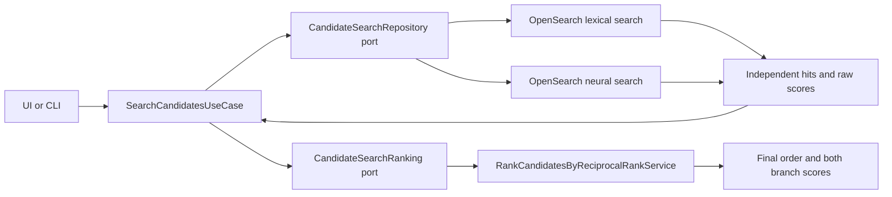

# Candidate search: independent retrieval and backend ranking

Start with [SearchCandidatesUseCase](../backend/dataSearch/application/useCases/searchCandidatesUseCase.ts).
It validates the query and limit, retrieves lexical and vector pools concurrently,
and passes both lists to an injected pure ranking service. The ranking service
merges candidates by Salesforce ID, calculates equal-weight reciprocal rank fusion
(RRF), sorts, and then applies the requested result limit.



## Responsibilities and dependencies

| File/class | Responsibility |
| --- | --- |
| `application/useCases/searchCandidatesUseCase.ts` | Validate input, select retrieval pool size, coordinate retrieval and ranking |
| `application/ports/candidateSearchRepository.ts` | Independent lexical/vector retrieval contract |
| `application/ports/candidateSearchRanking.ts` | Pure ranking contract |
| `application/services/rankCandidatesByReciprocalRankService.ts` | Merge by ID and calculate final order |
| `application/models/candidateSearchHit.ts` | Raw branch score and candidate document |
| `application/models/candidateSearchResult.ts` | Combined score, branch positions, raw scores and document |
| `infrastructure/repositories/candidateOpenSearchSearchRepository.ts` | Execute SDK requests and map responses |
| `infrastructure/mappers/candidateIndependentSearchRequestMapper.ts` | Build independent requests and explicitly bypass search pipelines |
| `infrastructure/lexicalSearch/candidateLexicalQueryMapper.ts` | Pure lexical query configuration |
| `infrastructure/vectorSearch/candidateVectorQueryMapper.ts` | Pure neural query configuration |
| `infrastructure/mappers/candidateSearchResponseMapper.ts` | Reject incomplete responses and restore raw hits |
| `backend/composition/createCandidateSearch.ts` | Constructor injection of repository, mappers and ranker |

The application depends on ports, pure candidate models and its existing Zod input
validator. It does not import the OpenSearch SDK or read environment variables.
The ranking service has no I/O, clock, network or UI dependencies. Routers remain
HTTP-only. Host mapping exposes results; it does not calculate scores.

## Retrieval settings

The query is trimmed and must contain 1-10,000 characters. The result limit is
1-100, default 20 in the use case. Each branch requests `max(limit * 3, 50)` hits
(50-300). A request for 10 results therefore retrieves up to 50 from each branch.
The union can contain up to twice that count before deduplication and final limiting.

Lexical configuration remains `multi_match`, `type: cross_fields`, and
`minimum_should_match: "2<30%"`. Field boosts remain:

| Field | Boost |
| --- | --- |
| skills | 10 |
| title | 8 |
| jobFunctions | 6 |
| systems | 5 |
| skillCategories | 4 |
| profile (including CV text) | 1 |

Vector retrieval uses the existing `embedding` field and `OPENSEARCH_MODEL_ID`.
The neural query's `k` equals the retrieval pool size. Embedding contents, Titan
model and index mapping are unchanged.

Both requests use the selected index, `allow_partial_search_results: false`,
`search_pipeline: "_none"`, and exclude the stored vector from returned source.
Explicit `_none` bypasses an index default search pipeline too. If either request
fails, times out or reports failed shards, the operation fails; it does not silently
rank only the successful branch.

## Backend ranking formula

Positions are one-based and follow each OpenSearch response's order:

```text
score = 1 / (60 + lexicalPosition) + 1 / (60 + vectorPosition)
```

An absent branch contributes zero. Equal scores use ascending Salesforce ID as a
stable tie-breaker. Repeated IDs within a branch contribute only their first hit.
A candidate present in both lists keeps the lexical branch's document. Ranking
does not mutate the input lists or candidate data.

Raw scores remain unchanged, including zero. An unavailable raw score is null;
a missing position means the candidate was not returned in that branch's pool.
These are different cases. RRF uses positions, not score magnitudes, so a large
score gap is not preserved by the combination formula.

The maximum combined score is `2 / 61` (about 0.032787), when first in both lists.
It is not a probability, percentage, or acceptance threshold. This change adds no
suitability rejection rule, reranker model, or guarantee that relevant candidates
exist in the retrieved pool. Live relevance must be evaluated separately.

## Existing installations and UI

No re-fetch, re-embedding or setup is needed for this ranking change. Restart the
backend and rebuild the UI with `npm run ui`, then search the same index.

The UI shows final rank, ranking score, raw lexical/vector scores and positions.
A missing branch displays **Not returned**. Old saved results display **Legacy
score** and **Not recorded** rather than pretending those scores came from RRF.
New score metadata is preserved in search history. CLI output prints RRF and both
branch scores and positions.

Setup still installs the former hybrid pipeline for compatibility. Its existing
25%/75% configuration and `OPENSEARCH_SEARCH_PIPELINE` no longer control this search
path; requests explicitly bypass it. Preparation and embedding behavior is unchanged.

## Verification

`npm run test:baseline` exercises the offline system, browser and architecture tests.
Focused tests cover overlap, missing branches, zero/null scores, ties, input
immutability, bounded pools, and rejecting partial searches. Contract fixtures now
provide different lexical/vector hits and assert final ranks and raw scores.
Only search-specific frozen artifacts were revised; preparation and embedding
artifacts remain byte-identical. Offline tests verify the algorithm and contracts,
not relevance on a live Salesforce dataset.
