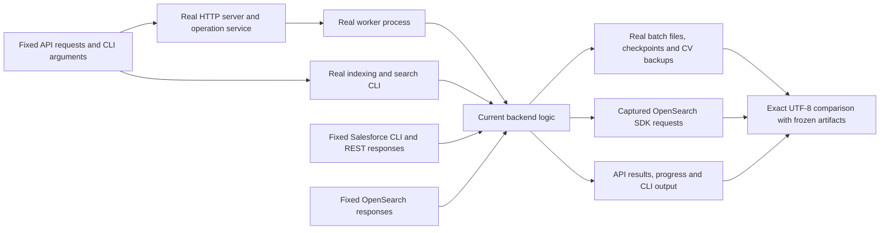

# Offline behavior baseline before refactoring

Production baseline: `ce48f4d589931a7c0196fa2f91bb1ed57e958b8e`.

**Post-refactor search revision:** Independent lexical and vector requests now feed
backend equal-weight RRF (rank constant 60). This is an approved behavior change.
The search response input, 16 search-related expected artifacts and their manifest
hashes were intentionally revised. All other frozen artifacts, including data
preparation and embedding requests/documents, remain unchanged. The scenario now
asserts both raw scores, branch positions, and the independently calculated RRF
score. Historical 25%/75% details below describe the original refactor baseline;
see [current search behavior](dataSearchRefactor.md) for the active implementation.


The refactor must preserve data preparation, embedding and search behavior. These
tests run the existing implementation before any production files are moved or
changed. No Salesforce login, AWS credentials, collection or live service is
required. Tests use temporary datasets, never the user's exported files or index.

## Run the baseline

```powershell
npm ci
npm run test:baseline
```

The combined command runs type checking, the existing 85 backend tests, the new
offline contracts, then the three existing browser workflows (including an Angular
build). On a fresh machine, install the browser once with
`npx playwright install chromium` if Playwright reports it missing.

To run only the new contracts:

```powershell
npm run test:contracts
```

**Do not use `npm run test:e2e` for this baseline.** That older command is a live
AWS indexing and relevance benchmark. It is intentionally excluded from
`test:baseline` and was not run for this work.

## What runs unchanged



Only external service boundaries and the worker clock are replaced. Salesforce
schema inspection, SOQL construction, REST continuation handling, relationship
joins, CV generation, serialization, embedding text, retry decisions, query
construction, response mapping and file I/O all run in the production code.
Workers reject outgoing network connections if a fixture fails to intercept one.
HTTP requests between the test and its local server remain real.

The OpenSearch fixture is **not a search engine**. It returns a deliberately fixed
order with tied and null scores, allowing tests to detect application-side changes
to ordering and mapping. These tests cannot certify actual Bedrock vectors,
OpenSearch ranking internals, service availability or relevance on real candidates.

## Exact comparison rules

`tests/e2e/fixtures/expected/` contains 88 captured artifacts. Comparisons use UTF-8
buffer equality, not sorted objects or substring matching. The manifest records
SHA-256 hashes of every input and expected artifact. Both must remain unchanged
during a behavior-preserving refactor.

- Batch files, checkpoints and backup checks preserve bytes, including key/array
  order, whitespace, Unicode, null/omitted fields, numeric values and text.
- Outgoing Salesforce and OpenSearch requests are serialized at their adapter
  boundaries and compared exactly. These are SDK request payload contracts,
  not AWS-signed HTTP wire bytes.
- Operation request, progress, result, error and ordered progress messages are
  captured. The server's random operation IDs and wall-clock envelope timestamps
  are excluded. OS-assigned file `modifiedAt` is excluded from embedding receipts;
  file hash and size remain checked.
- The worker clock is fixed at `2026-10-28T00:00:00.000Z`. Business timestamps such
  as `exportedAt`, `indexedAt` and CV generation time remain in the expectations.
- CLI indexing's temporary workspace path is replaced with `<workspace>` and
  diagnostic path separators are normalized. Candidate data and request payloads
  receive no such normalization.

Failed comparisons write actual artifacts to `.cache/contract-diffs/`; tests never
rewrite expected files. `.gitattributes` keeps fixtures LF-terminated on Windows.

## Functional coverage

| Requirement | Offline acceptance coverage | Additional existing coverage |
| --- | --- | --- |
| Fetch bounded files and progressively resume | Real API/worker export of 3 + 3 + 2 records; exact files, cursors and SOQL; short REST pages; completed resume; reject changed batch size/restart | 1,000-record browser export; simulated 1,254,365 records across 1,255 batches; exact-multiple empty probe |
| Resolve full candidate relationships | Candidate and preregistration scope; exclude client; both association tags; recursive parents; repeated associations; language/proficiency; employer and profile lookups; unknown/missing/cyclic tags; missing employer; zero/false values; Unicode | Required/optional schema fields, configurable tag categories and scope fingerprints, large lookup selections |
| Preserve a usable dataset after failure | Real relationship-fetch failure leaves committed bytes and cursor unchanged; restart and resume without duplicate IDs | Failed file/checkpoint writes, locks, stop after current batch, malformed/missing snapshots and checkpoints |
| Generate demo CVs without changing Salesforce facts | Preview leaves file untouched; add all selected batches; original backups; repeated add; fixed seeds; regenerate one selected file; remove and repeat remove | Coherence, Java versus JavaScript, shared locks, validation before writes, stop/retry |
| Prepare OpenSearch resources | Exact connector/model requests, embedding simulation, index mappings, ingest/search pipelines; explicit existing model and repeat setup; manual pipeline names | Old BGE mapping rejection, shared pipeline/model incompatibility, invalid vectors |
| Embed selected files progressively | First file then remaining files; same-ID upserts; CV regeneration update; second index isolation; complete document/profile/searchText payloads | 100-document bulk boundaries, selected IDs, oversized selection handling, unsearchable candidates |
| Retry/fail without hiding errors | Selective 429 retry; permanent 400 rejection; incomplete acknowledgements; recovery; CV removal deletes formerly synthetic-only document | Exhausted retries, deletion retries/idempotency, stop at current bulk, changed-file protection |
| Preserve search configuration and outputs | Exact hybrid requests for limits 1/20/100; whitespace and Unicode; fixed result order/ties/null score; DTOs and profiles; CLI text; empty results; unavailable/timed-out/failed-shard responses | Input validation and adapter-level request checks |
| UI behavior and progress | Existing three browser workflows: configuration, fetch/resume/preview, setup, embed, activity, search tables/details, errors, stop/resume, CV lifecycle and mobile layout | Local origin/token, SSE progress, profile persistence, concurrent-operation rules |
| Validate requests before work | Empty query, invalid limit, duplicate files and path traversal rejected with exact errors and no external requests | CLI flags, source and index validation before authentication |

The contract fixture is intentionally small enough to review. Large-volume and
boundary cases remain in the existing focused tests; a small golden dataset does
not by itself prove scalability or equivalence for every possible input.

## Search settings preserved by the baseline

There is one hybrid OpenSearch request. The application does not rerank its results.

| Setting | Current value | Current definition |
| --- | --- | --- |
| Lexical query | `multi_match`, `type: cross_fields` | `backend/dataSearch/infrastructure/lexicalSearch/candidateLexicalQueryMapper.ts` |
| Field boosts | `skills^10`, `title^8`, `jobFunctions^6`, `systems^5`, `skillCategories^4`, `profile` | Lexical mapper |
| Match threshold | `minimum_should_match: "2<30%"` | Lexical mapper |
| Vector query | Neural query on `embedding`, configured `model_id`, plain `query_text` | `backend/dataSearch/infrastructure/vectorSearch/candidateVectorQueryMapper.ts` |
| Vector candidates | `k = Math.max(limit * 3, 50)` | Vector mapper |
| Returned size | Requested limit; API validates 1?100 | `SearchCandidatesUseCase` / `CandidateHybridSearchRequestMapper` |
| Partial results | `allow_partial_search_results: false`; reject timeout or failed shards | `CandidateHybridSearchRequestMapper` / `CandidateSearchResponseMapper` |
| Normalization | `min_max` | `backend/dataSearch/infrastructure/config/candidateHybridSearchPipeline.json` |
| Combination | `arithmetic_mean`, weights `[0.25, 0.75]` in lexical/vector query order | Same pipeline file |
| Embedding | Titan V2, normalized 1,024 dimensions; cosine similarity; ingest `searchText` → `embedding`, processor batch size 1 | Captured setup requests in `10-setup-register.requests.jsonl` |

The 25%/75% weights combine normalized scores. They do not specify percentages of
returned candidates. The baseline freezes these settings without introducing a
separate ranking implementation.

## Resolved defect: restart after CV enrichment

The original baseline recorded a startup failure after an `enrich` operation:
`JsonOperationHistoryStore` did not recognize that saved operation kind. This has
now been fixed as a separate behavior change. History also preserves enrichment
results, the `changed` progress counter, and embedding `deleted` counts.

The acceptance scenario now restarts the real local server with mixed fetch,
enrichment, setup, embedding and search history. It verifies every operation's
full details survive, including all four CV actions and the raw search scores.
Candidate batch files and indexed documents are unchanged by restarting.
Focused tests cover every operation kind, legacy search results, zero counters,
and rejection of malformed history. The existing golden artifacts are unchanged.

Existing `.cache/ui/operations.json` files containing valid enrichment records
load directly after updating. No history deletion, data re-fetch or re-embedding
is required. Fields discarded by an older version cannot be reconstructed.

## Keeping the baseline intact during refactoring

1. Run `npm run test:baseline` before moving any production code.
2. Review the plan for data preparation first, then embedding, then search.
3. Keep scenario inputs, expected artifacts and existing assertions unchanged.
4. If source files move, update only the launch/import bindings in
   `tests/support/current-backend-bindings.ts` for the new contracts. Existing
   focused tests may need import-path changes, without changing assertions. Two test-only
   construction drivers adapt the former fetch/CV constructors to the separate preparation
   use cases; test inputs and assertions remain the same.
5. Run the same `npm run test:baseline` after each module. Investigate byte diffs;
   do not regenerate expectations to make a refactor pass.

The one-time baseline capture utility was retired after the refactor. The frozen
fixtures and manifest remain the source of truth; test commands compare against
them and do not regenerate or overwrite expectations.
During initial fixture review, a shell-encoding issue in the synthetic Japanese
input was corrected before finalizing the baseline; production code was unchanged.

The test design keeps workflow assertions separate from service fixtures, process
launch bindings and captured expectations. It adds no production switches or test
hooks. The completed preparation refactor is described in [dataPreparationRefactor.md](dataPreparationRefactor.md).

## Embedding refactor verification

The setup/indexing split preserves the same 88 artifacts and existing test bodies.
Two architecture/style checks bring the backend suite to 87 tests. See
[dataEmbeddingRefactor.md](dataEmbeddingRefactor.md) for the dependency boundaries,
shared document relocation and construction-only test bindings.


## Preparation Clean Architecture verification

The preparation application/infrastructure split and shared domain move passed
`npm run test:baseline` and `npm run build`. The backend suite now has 90 tests
(the previous 87 plus three preparation/domain architecture checks), with the same
two contract tests and three browser workflows.

All 88 expected artifacts match. All 92 fixture files, including input and manifest
files, are unchanged. A source audit confirmed 41 existing test bodies are unchanged
apart from the moved CLI mock-module path; constructor adaptations stay in the test
support drivers. The 58 TypeScript files in embedding, search, shared candidate-file
storage and Angular retain their non-import/export statements unchanged.


## Search Clean Architecture verification

`npm run test:baseline` and `npm run build` passed after separating the search use
case, lexical/vector query mappers, hybrid request mapper, SDK repository and
response mapper. The backend suite now contains 93 tests: the previous 90 plus
three search architecture/style checks. Both offline contract tests and all three
browser workflows pass, with all 88 expected artifacts matching byte-for-byte.

All 92 fixture files and the scoring pipeline JSON are unchanged. Existing test
assertions remain; import aliases and a construction-only driver wire the new
implementations. The optional live benchmark's source fingerprint now hashes the
split search files rather than the removed single adapter. Its scenarios, query
behavior and judgments are unchanged; it was not run against AWS.

The source audit confirms 92 TypeScript files in preparation, embedding, shared
candidate storage/models and Angular retain their non-import/export statements.
The search settings and execution diagram are documented in
[dataSearchRefactor.md](dataSearchRefactor.md).
